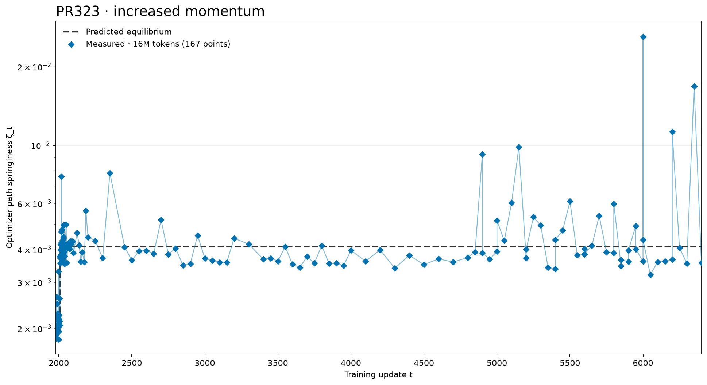
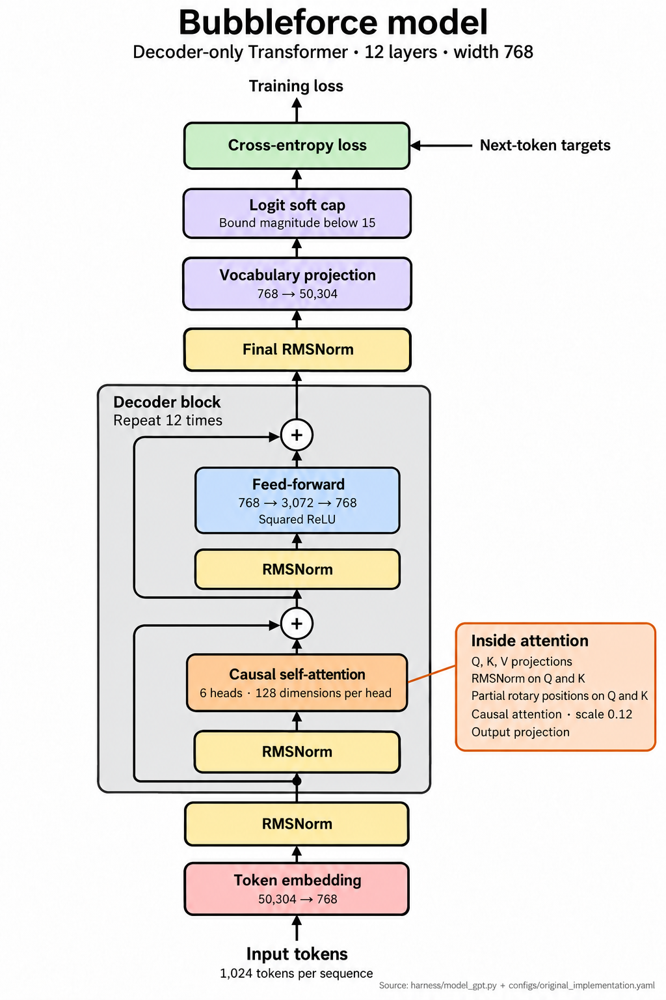

# bubbleforce

This repository contains source code for the blog post by Jeffrey Cheng and Jack Zheng.

1. [Preliminaries](#preliminaries)
2. [Start training with an experiment config](#start-training-with-an-experiment-config)
3. [Restart training from a checkpoint](#restart-training-from-a-checkpoint)
4. [Measure path spring at a snapshot or a given frequency](#measure-zeta-at-a-snapshot-or-a-given-frequency)
5. [Experiment arguments](#experiment-arguments)
6. [Code guide](#code-guide)

## Preliminaries

To run commands you must use a CUDA-enabled PyTorch installation and one of the supplied experiment configurations. First, install the Python dependencies:

```bash
python -m pip install -r requirements.txt
```

Then, download the FineWeb token shards once:

```bash
python data/cached_fineweb10B.py 20
```

## Quickstart

Let's briefly walk through how you can reproduce our experiments in the blog.

### Start training with an experiment config

For all our experiments, we train on FineWeb10B with GPT-2 tokenization and next-token cross-entropy loss.

You can select an experiment config from `configs/` to set training, measurement, and model options. We have provided the 6 experiment configs we used in the blog. Our supplied configs use eight GPUs.

Start training from scratch with:

```bash
python run.py original_implementation
```

Our [original implementation config](configs/original_implementation.yaml) uses Muon with exponential moving average (EMA) momentum, decay `0.95`, and Nesterov mix `0.95`. The trainer holds all learning rates constant for the first 30% of training, then reduces them linearly toward zero over the remaining 70%.

You can inspect the settings with:

```bash
python run.py original_implementation --print-settings
```

Choose another experiment with its corresponding command:

| Experiment           | Description                                                                                                                                                                                                                                                                       | Command                            |
| -------------------- | --------------------------------------------------------------------------------------------------------------------------------------------------------------------------------------------------------------------------------------------------------------------------------- | ---------------------------------- |
| MaxEntSlop           | Here we switch from exponential moving average (EMA) momentum to the MaxEntSlop kernel at update `1000`, then interpolate its settings through to update `3250`. We retain the original learning-rate cooldown. You can read the full settings in maxentslop.yaml.                | `python run.py maxentslop`         |
| Double learning rate | Here we use a constant learning rates until update `2009`, then multiply every optimizer group's learning rate by `2`. You can read the full settings in lr_double.yaml.                                                                                                          | `python run.py lr_double`          |
| Half learning rate   | Here we use constant learning rates until update `2009`, then multiply every optimizer group's learning rate by `0.5`. You can read the full settings in lr_half.yaml.                                                                                                            | `python run.py lr_half`            |
| Increased momentum   | At update `2009`, we change Muon decay and Nesterov mix from `0.95` to `0.9750961447125188` which was chosen to double the maximum tolerable bubbleforce. We keep learning rates constant through training. You can read the full settings in increased_momentum.yaml.            | `python run.py increased_momentum` |
| Decreased momentum   | At update `2009`, we change Muon decay and Nesterov mix from `0.95` to `0.8990666066208468` which was chosen to halve the maximum tolerable bubbleforce. We also keep learning rates constant through training. Again, you can read the full settings in decreased_momentum.yaml. | `python run.py decreased_momentum` |

### Log experiment results

The runner captures the model weights, momentum buffer and optimizer settings at selected updates, then measures the bubbleforce at those snapshots after training finishes.

By default, snapshots are saved at:

```text
runs/spectrum/<experiment>/captures/
```

You can choose a different output directory by adding `measurement.output_dir=PATH` to the training command. Each run requires a directory that does not already exist. For example:

```bash
python run.py original_implementation \
  measurement.output_dir=runs/spectrum/original_trial_1
```

With this command:

- **Model and optimizer snapshots** are saved in `runs/spectrum/original_trial_1/captures/`
- **Training logs** in `runs/spectrum/original_trial_1/training/train.log`
- **Measurement results** in `runs/spectrum/original_trial_1/spectra/`

### Graph training loss

To plot the mean training cross-entropy per token, averaged across all GPUs, run:

```bash
python makefig.py train-loss runs/spectrum/original_implementation \
  --output figures/train_loss.png
```

The command saves the graph to `figures/train_loss.png`. Each point on the graph uses the training batch before its optimizer update and the horizontal axis counts completed updates.

## Restart training from a checkpoint

Since runs are expensive, if you prefer to continue a saved run, we provide snapshots and restart checkpoints in the [checkpoint bucket](https://huggingface.co/buckets/jacknzheng/bubbleforce).

You can browse `snapshots/<experiment>/` or `restarts/<experiment>/` to find:

- **Snapshots:** You can use a snapshot to calculate bubble pressure at a saved update.
- **Restart checkpoints:** You can resume training from a saved update as well as compute bubble pressure.

Here's how to resume training from a restart checkpoint:

1. For this example, you can first download the supplied decreased-momentum restart at boundary `2201` (approximately 95 GB):

   ```bash
   hf buckets sync \
     hf://buckets/jacknzheng/bubbleforce/restarts/decreased_momentum/decreased_momentum__checkpoint_002201 \
     ./decreased_momentum__checkpoint_002201
   ```

2. Once the download finishes, you can set `training.resume_checkpoint` to the nested checkpoint directory, with overrides matching the saved run's 6,475-update schedule and 8 sequences per microbatch. The following command then resumes training through update `2210` and measures that update:

   ```bash
   python run.py decreased_momentum \
     training.train_steps=6475 \
     training.microbatch_sequences=8 \
     training.resume_checkpoint=./decreased_momentum__checkpoint_002201/checkpoint_002201 \
     'measurement.measured_updates=[2210]' \
     measurement.output_dir=runs/spectrum/decreased_momentum_restart
   ```

You must use the checkpoint's training recipe and GPU count. The runner stops after the last explicit measurement update unless `training.stop_step` is supplied.

To save restart checkpoints during a new run, enable a checkpoint interval:

```bash
python run.py original_implementation \
  training.checkpoint.every=500 \
  measurement.output_dir=runs/spectrum/original_with_checkpoints
```

This saves full checkpoints every 500 completed updates and at the final boundary, under the run's `captures/` directory.

## Measure $\zeta$ at a snapshot or a given frequency

To compute optimizer path spring, $\zeta_t$, the runner saves weights and momentum at specified updates during training. Here, $t$ is the training update.

After training finishes, it loads each saved update and estimates the largest positive real eigenvalue of the normalized Muon restoring response, using 16,777,216 validation tokens per measurement.

### Specify measurement frequency

If you'd like to measure $\zeta_t$ at a fixed interval, set `measurement.measure_every` to the desired interval. The default is every **50 updates**, including update `0` and the final update: `0, 50, 100, ..., 3200, 3249` for a 3,250-update run.

```bash
python run.py increased_momentum \
  measurement.measure_every=50 \
  measurement.output_dir=runs/spectrum/increased_momentum_every50
```

The runner records snapshots during training, then computes their measurements after training.

Results are saved under `spectra/update_<NNNNNN>/` within the output directory.

### Graph $\zeta$

To plot the leading eigenvalue estimate at each saved update use the following command:

```bash
python makefig.py zeta runs/spectrum/increased_momentum_every50 \
  --output figures/zeta.png
```



### Measure a saved snapshot

We have also provided snapshots we recorded during our runs. As an example, you can download the supplied decreased-momentum snapshot at update `2025`:

```bash
hf buckets sync \
  hf://buckets/jacknzheng/bubbleforce/snapshots/decreased_momentum/decreased_momentum__update_002025 \
  ./decreased_momentum__update_002025
```

Set `training=null`, as to not kick off a new run, then simply pass in the downloaded directory and select its update:

```bash
python run.py decreased_momentum \
  training=null \
  measurement.capture_dir=./decreased_momentum__update_002025 \
  'measurement.measured_updates=[2025]' \
  measurement.output_dir=runs/spectrum/decreased_momentum_snapshot2025
```

This loads the snapshot for measurement.

You can use it to rerun the eigenvalue solver with a larger Krylov basis if the residual error is too high. For snapshots from your own run, point `measurement.capture_dir` to that run's `captures/` directory.

## Experiment arguments

To run `python run.py EXPERIMENT key=value ...`, the experiment name is required. The selected experiment YAML supplies defaults for the optional arguments below, which can be overridden by passing in the specified CLI arguments.

### Required argument

- `experiment` [`str`]: Choose `original_implementation`, `maxentslop`, `lr_double`, `lr_half`, `increased_momentum`, or `decreased_momentum`.

### Optional arguments

- `--print-settings` [`bool` flag, default: `false`]: Print the resolved settings and exit. Add the flag without a value.
- `world_size` [`int`, default: `8`]: Set the number of GPU workers. Match the saved process count when loading snapshots or restarting training.
- `measurement.output_dir` [`str` (path), default: `runs/spectrum/<experiment>`]: Save results in a new directory. By default, training logs go in its `training/` subdirectory and snapshots go in `captures/`.
- `training.train_steps` [`int`, default: `3250`]: Set the training schedule length. The default runs updates `0` through `3249`; changing it also changes the learning-rate cooldown timing.
- `training.seed` [`int`, default: `0`]: Change the model initialization seed. The trainer adds the configured seed offset before initializing parameters.
- `training.microbatch_sequences` [`int`, default: `64`]: Process this many 1024-token sequences per GPU at a time. Reduce it to save memory; it must divide the local sequence count.
- `measurement.measure_every` [`int`, default: `50`]: Measure every this many training updates, including update `0` and the final update.
- `measurement.measured_updates` [`list[int]` or `null`, default: `null`]: Measure specific updates instead of using the interval above. Unless `training.stop_step` is set, training stops after the last selected update.
- `measurement.token_counts` [`list[int]`, default: `[16777216]`]: Calculate eigenvalues using each requested number of validation tokens across all GPUs. Supply positive, distinct, increasing counts divisible by `world_size * measurement.sequence_length`.
- `measurement.microbatch_sequences` [`int`, default: `16`]: Process this many validation sequences per GPU at a time during measurement. Reduce it to save memory.
- `measurement.eigensolver.num_requested_eigenpairs` [`int`, default: `1`]: Estimate this many leading positive real eigenvalues and their eigenvectors.

## Code guide

Start with `run.py` to follow an experiment from configuration through training and measurement.

| File or directory           | Purpose                                                                                                               |
| --------------------------- | --------------------------------------------------------------------------------------------------------------------- |
| [run.py](run.py)            | Reads experiment settings and CLI overrides, then launches training and measurement.                                  |
| configs/                    | Sets training, measurement, and model options through experiment YAML files and Python configuration classes.         |
| harness/                    | Defines the GPT model, runs training, saves snapshots, and restores checkpoints. Start with loop.py and model_gpt.py. |
| optimizers/ringed/          | Applies Muon updates and constructs EMA and MaxEnt momentum kernels.                                                  |
| bubbleforce/run_analysis.py | Loads saved snapshots, runs eigenvalue measurements, and calculates predicted equilibria.                             |
| bubbleforce/analysis/       | Computes Muon response derivatives, solves for eigenvalues, and calculates bubbleforce stability boundaries.          |
| tests/                      | Checks numerical calculations, configuration handling, and checkpoint workflows.                                      |

## Model config


