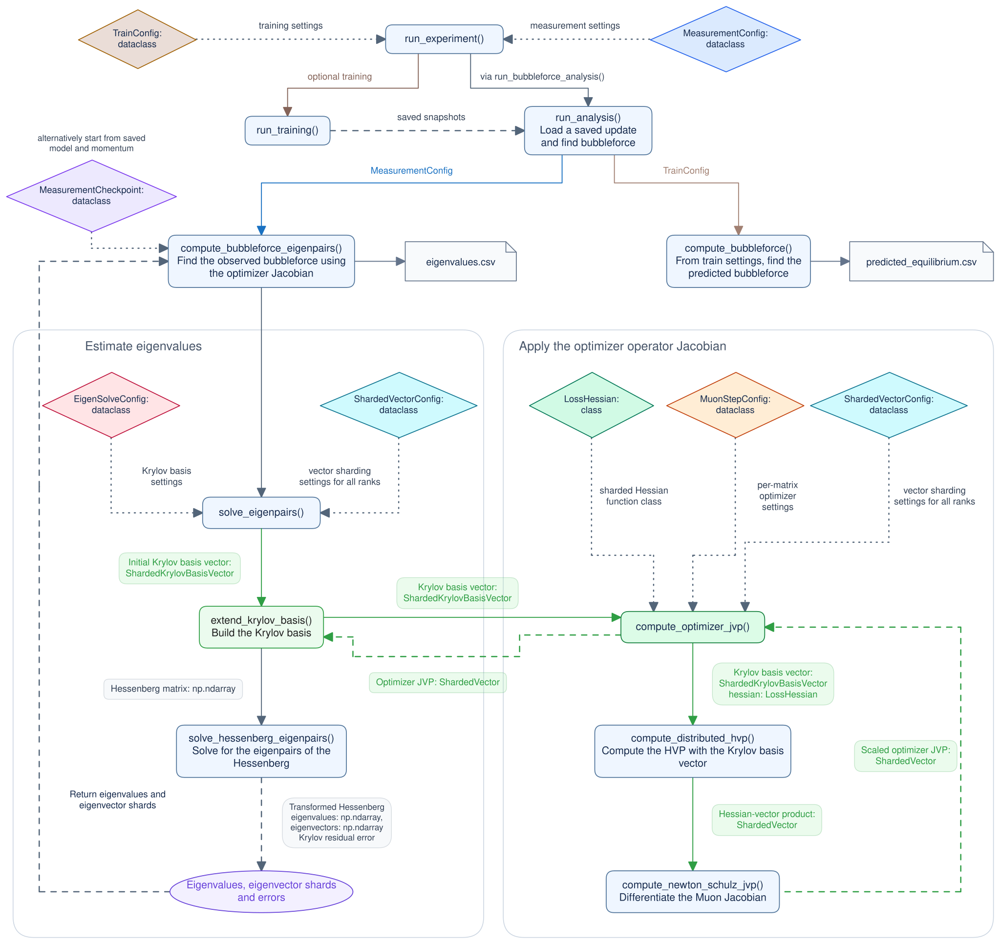

# bubbleforce

This repository contains source code for the blog post by Jeffrey Cheng and Jack Zheng.

1. [Preliminaries](#preliminaries)
2. [Start training with an experiment config](#start-training-with-an-experiment-config)
3. [Resume training from a checkpoint](#resume-training-from-a-checkpoint)
4. [Measure bubbleforce at a snapshot or a given frequency](#measure-zeta-at-a-snapshot-or-a-given-frequency)
5. [Experiment arguments](AGENTS.md#experiment-arguments)
6. [Code guide](AGENTS.md#code-guide)
7. [Codebase architecture](#codebase-architecture)

## Preliminaries

To run commands you must use a CUDA-enabled PyTorch installation and one of the supplied experiment configurations. First, install the Python dependencies:

```bash
python -m pip install -r requirements.txt
```

Then, download the FineWeb token shards once:

```bash
python data/cached_fineweb10B.py 20
```

## Quickstart

Let's briefly walk through how you can reproduce our experiments in the blog.

### Start training with an experiment config

For all our experiments, we train on FineWeb10B with GPT-2 tokenization and next-token cross-entropy loss.

You can select an experiment config from `configs/` to set training, measurement, and model options. We have provided the 6 experiment configs we used in the blog. Our supplied configs use eight GPUs.

Pass the YAML file path to start training from scratch:

```bash
python3 run.py configs/nanogpt_muon_baseline.yaml
```

Our [nanoGPT Muon baseline config](configs/nanogpt_muon_baseline.yaml) follows [Konstantin's PR #323](https://github.com/KellerJordan/modded-nanogpt/pull/323) and uses Muon with exponential moving average (EMA) momentum, decay `0.95`, and Nesterov mix `0.95`. The trainer holds all learning rates constant for the first 30% of training, then reduces them linearly toward zero over the remaining 70%.

You can inspect the settings with:

```bash
python3 run.py configs/nanogpt_muon_baseline.yaml --print-settings
```

Choose another experiment with its corresponding command:

| Experiment           | Settings                                                                                                | Command                                          |
| -------------------- | ------------------------------------------------------------------------------------------------------- | ------------------------------------------------ |
| MaxEntSlop           | Single EMA momentum → MaxEntSlop kernel at update `1000`, interpolated through `3250`. LR cooldown kept | `python3 run.py configs/maxentslop.yaml`         |
| Double learning rate | Constant LR then all LRs × `2` at update `2009`                                                         | `python3 run.py configs/lr_double.yaml`          |
| Half learning rate   | Constant LR then all LRs × `0.5` at update `2009`                                                       | `python3 run.py configs/lr_half.yaml`            |
| Increased momentum   | Constant LR then Muon decay and Nesterov mix change from `0.95` → `0.9750961447125188` at update `2009` | `python3 run.py configs/increased_momentum.yaml` |
| Decreased momentum   | Constant LR then Muon decay and Nesterov mix change from `0.95` → `0.8990666066208468` at update `2009` | `python3 run.py configs/decreased_momentum.yaml` |

### Log experiment results

The runner captures the model weights, momentum buffer and optimizer settings at selected updates, then measures the bubbleforce at those snapshots after training finishes.

By default, snapshots are saved at:

```text
runs/spectrum/<experiment>/captures/
```

You can choose a different output directory by adding `measurement.output_dir=PATH` to the training command. Each run requires a directory that does not already exist. For example:

```bash
python3 run.py configs/nanogpt_muon_baseline.yaml \
  measurement.output_dir=runs/spectrum/original_trial_1
```

The runner calls `predict_bubbleforce` for the single Muon group at every training update, then writes `update` and `predicted_zeta` to `<output_dir>/predicted_equilibrium.csv`.

## Resume training from a checkpoint

We also provide restart checkpoints to resume training at various steps. Commands and instructions [are here in the AGENTS.md](AGENTS.md#restart-training-from-a-checkpoint)

## Measure $\zeta$ at a snapshot or a given frequency

To compute bubbleforce, $\zeta_t$, the runner saves weights and momentum at specified updates during training. Here, $t$ is the training update.

After training finishes, it loads each saved update and estimates the largest positive real eigenvalue of the normalized Muon restoring response, using 16,777,216 validation tokens per measurement.

If, for example, the residual error from the Arnoldi eigenvalue approximation is too large, we provide [commands to rerun Arnoldi iterations in AGENTS.md](AGENTS.md#rerun-arnoldi-with-a-larger-krylov-basis) with a larger Krylov basis.

### Specify measurement frequency

If you'd like to measure $\zeta_t$ at a fixed interval, set `measurement.measure_every` to the desired interval. The default measurement frequency is every 50 updates.

```bash
python3 run.py configs/increased_momentum.yaml \
  measurement.measure_every=50 \
  measurement.output_dir=runs/spectrum/increased_momentum_every50
```


## Codebase architecture



Edit [architecture.excalidraw](architecture.excalidraw), then export it as `figures/architecture-excalidraw.svg`.
